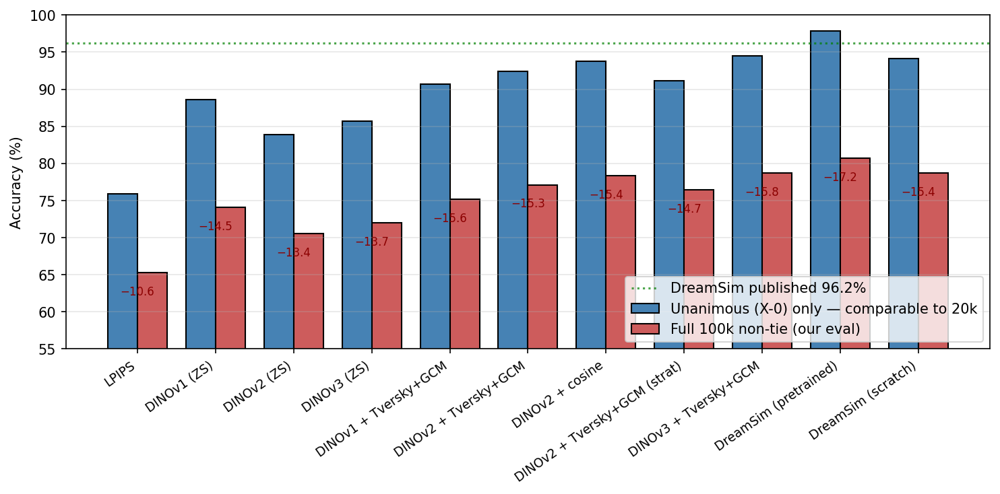
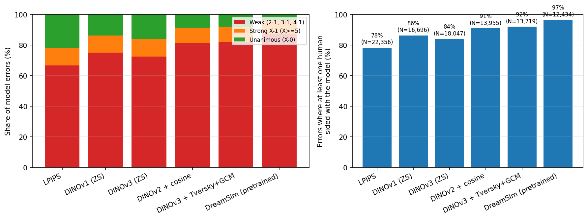

# Cosine is Nearly Human: The Reproducibility Ceiling of Perceptual Similarity

Reproducibility package for the paper *"Cosine is Nearly Human: The Reproducibility Ceiling of Perceptual Similarity"*.

- The public NIGHTS release ships only the **20,019 unanimous-agreement triplets** out of **100,000 originally collected**.
- We evaluate **twelve** perceptual similarity methods on the **full 64,420 non-tie triplets** under 5-fold cross-validation.
- We introduce a **split-half bootstrap reproducibility ceiling** over raw vote counts (hypergeometric PMF) that generalizes across benchmarks.

The submitted PDF is at [`paper/nights_rigorous.pdf`](paper/nights_rigorous.pdf); the camera-ready PDF will replace it once final.

---

## Headline results



Every method loses **10–17 percentage points** when moved from the unanimous-agreement subset (NIGHTS-20k) to the full NIGHTS-100k corpus. The published DreamSim score of 96.2% reflects the 20% easiest part of the collected data.

| Method | NIGHTS-100k non-tie (5-fold) |
|---|---|
| LPIPS (AlexNet) | 65.3 ± 0.2 |
| DINOv1 zero-shot | **74.1 ± 0.5** (best zero-shot) |
| DINOv2 zero-shot | 70.6 ± 0.4 |
| DINOv3 zero-shot | 72.0 ± 0.4 |
| Harmonized DINOv3 (Fel 2022) | 64.0 ± 0.2 (negative result) |
| DINOv2-LoRA + cosine head | 78.4 ± 0.4 |
| DINOv2-LoRA + Cog-v3 head | 77.1 ± 0.5 |
| DINOv2-LoRA + Tversky NN (Doumbouya 2025) | 77.4 ± 0.5 |
| DINOv3-LoRA + Cog-v3 head | **78.7 ± 0.3** (best single backbone) |
| DreamSim ensemble (pretrained) | **80.7 ± 0.2** (best overall) |
| DreamSim ensemble (scratch, 100k) | 78.7 ± 0.7 |

**Split-half reproducibility ceiling: 70.1% on NIGHTS-100k non-tie** (33% on 2-1, 50% on 3-1, 100% on X-0). Reported accuracies above this ceiling reflect fitting the specific voter sample rather than a reproducible human-preference signal. The same methodology applied to BAPPS gives a ceiling of **69.0%**, within 1 pp of NIGHTS, demonstrating the framework generalizes.



For the best method (DreamSim), **87% of errors fall on weak-majority triplets** where the human vote itself was close to a coin-flip. On **96.6% of its wrong predictions at least one human voter sided with the model**. The remaining 20% of errors are not model failures; they are triplets where humans themselves were split.

---

## Install

```bash
pip install -e .
```

This installs the `cih` console script. Python ≥ 3.10 is required. For the DreamSim-Scratch row of the main table, clone the authors' training code separately into `third_party/dreamsim/`.

## Data

The project expects two 2AFC datasets under `data/`:

- `data/nights_unfiltered/` — raw NIGHTS corpus. The important files are `nights_raw_2afc.csv` (100k triplets with vote proportions and vote counts) and the image folders `dataset_unfiltered/ref/` and `dataset_unfiltered/distort/`. Download instructions are in the DreamSim repository.
- `data/bapps/2afc/val/` — BAPPS 2AFC validation split used for the ceiling-generalization analysis and the zero-shot sanity check.

Neither dataset is redistributed here; both are available from their original authors.

---

## CLI

Everything is driven by a single entry point, `cih`, with four command groups: **train**, **eval**, **analyze**, **viz**.

```bash
cih --help
cih <group> <command> --help
```

### Train

```bash
cih train lora --config configs/lora_cog_v3.yaml --fold 0 --gpu 0
cih train lora --config configs/lora_cosine.yaml --fold 2 --gpu 1
cih train lora --config configs/lora_tnn.yaml    --fold 3 --gpu 0

# DreamSim ensemble retraining (shells out to the authors' public training code)
cih train dreamsim-scratch --config configs/dreamsim_scratch.yaml --fold 0 --gpu 0
```

Checkpoints land under `results/` with names of the form `{tag}_fold{k}_best.pt`.

### Evaluate

Evaluate a zero-shot or trained method on NIGHTS-100k; writes per-triplet predictions to CSV for downstream analyses:

```bash
cih eval nights --method dinov3        # 5-fold, zero-shot
cih eval nights --method dinov3_lora_cog_v3 --checkpoint results/dinov3_lora_cog_v3_fold0_best.pt --fold 0
cih eval nights --method dreamsim_pretrained

# BAPPS sanity check (6 distortion categories)
cih eval bapps  --method lpips
cih eval bapps  --method dinov3
```

### Analyze

All analyses read the per-triplet prediction CSVs; no retraining needed.

```bash
cih analyze ceiling --dataset nights              # 70.1% split-half ceiling
cih analyze ceiling --dataset bapps               # 69.0% BAPPS ceiling
cih analyze kappa   --out figures/kappa.pdf       # pairwise Cohen's kappa heatmap
cih analyze mcnemar                                # paired McNemar tests
cih analyze errors  --out figures/errors.pdf      # "where do errors live" plot
cih analyze imagenet-split                         # ImageNet vs non-ImageNet subset accuracy
```

### Regenerate paper figures

```bash
cih viz drop-chart       --out figures/drop_chart.pdf
cih viz agreement-curve  --out figures/agreement_curve.pdf
cih viz errors           --out figures/error_distribution.pdf
```

---

## Reproducing the main table

```bash
# 1. Zero-shot baselines (no training)
for m in lpips dinov1 dinov2 dinov3 dreamsim_pretrained; do
  cih eval nights --method "$m"
done

# 2. LoRA methods (one config per head)
for cfg in configs/lora_cog_v3.yaml configs/lora_cosine.yaml configs/lora_tnn.yaml; do
  for f in 0 1 2 3 4; do
    cih train lora --config "$cfg" --fold "$f" --gpu 0
  done
done

# 3. Analyses
cih analyze ceiling --dataset nights --out results/ceiling_nights.json
cih analyze ceiling --dataset bapps  --out results/ceiling_bapps.json
cih analyze kappa                    --out figures/kappa_matrix.pdf
cih analyze errors                   --out figures/error_distribution.pdf
cih analyze mcnemar                  --out results/mcnemar.json
cih analyze imagenet-split           --out results/imagenet_split.json

# 4. Regenerate paper figures
cih viz drop-chart      --out figures/drop_chart.pdf
cih viz agreement-curve --out figures/agreement_curve.pdf
```

---

## Repository layout

```
cosine_is_human/
├── paper/                       # Paper PDF
├── figures/                     # Pre-rendered headline figures (PNG)
├── configs/                     # YAML configs per trained variant
└── src/cosine_is_human/
    ├── cli.py                   # argparse dispatch
    ├── data/                    # NIGHTS and BAPPS loaders, fold splits
    ├── models/                  # Backbones (DINO v1/v2/v3), heads, LoRA wrapper
    ├── train/                   # LoRA training loop, DreamSim-Scratch shim
    ├── eval/                    # NIGHTS + BAPPS evaluation
    ├── analysis/                # Split-half ceiling, kappa, McNemar, error distribution
    └── viz/                     # Paper figure regeneration
```

---

## Citation

```bibtex
@inproceedings{tenwolde2026cosine,
  title     = {Cosine is Nearly Human: The Reproducibility Ceiling of Perceptual Similarity},
  author    = {TenWolde, Benjamin and de Sa, Virginia R.},
  booktitle = {Advances in Neural Information Processing Systems (NeurIPS), Evaluations and Datasets Track},
  year      = {2026}
}
```

## License

MIT. See [LICENSE](LICENSE).
